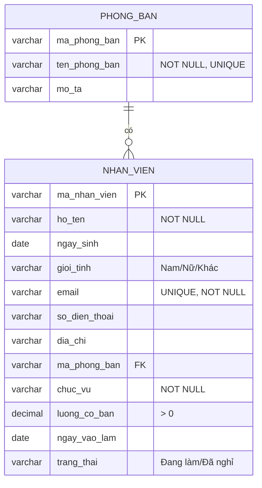

# Employee Management System (EMS) – phần Java Console + JDBC + MySQL

Chương trình console quản lý nhân viên và phòng ban, kiến trúc phân tầng
`Controller → Service → Repository → MySQL`. Phần web prototype nằm ở thư mục riêng `employee-management-web/`
và **chưa kết nối** với phần Java này (đúng phạm vi đề bài).

## Yêu cầu môi trường
- JDK 21, Maven 3.9+
- MySQL 8.0.16+ (hoặc XAMPP có MySQL 8 / MariaDB 10.5+ cũng chạy được CHECK constraint)

## Cài đặt và chạy
1. Tạo CSDL và dữ liệu mẫu:
   ```bash
   mysql -u root -p < database/ems.sql
   ```
2. Cấu hình kết nối (chọn một trong hai cách):
   - Sửa `src/main/resources/db.properties`, hoặc
   - Đặt biến môi trường `EMS_DB_URL`, `EMS_DB_USER`, `EMS_DB_PASSWORD` (khuyên dùng cho mật khẩu thật).
3. Build, test và chạy:
   ```bash
   mvn clean package
   mvn exec:java
   ```
   Trên Windows, chạy `chcp 65001` trước để console hiển thị tiếng Việt đúng.

## Cấu trúc
```
src/main/java/com/company/ems/
├── config/DatabaseConnection.java     kết nối JDBC (env > db.properties)
├── model/                             NhanVien, PhongBan, BoLoc, SapXep, ThongKePhongBan (record/enum bất biến)
├── exception/                         EmsException, ValidationException, DataAccessException
├── repository/                        NhanVienRepository, PhongBanRepository (PreparedStatement)
├── service/                           NhanVienService, PhongBanService, NhanVienValidator
├── controller/NhanVienController.java menu console
└── App.java                           lắp ghép các tầng
database/ems.sql                       schema + dữ liệu mẫu (chạy lại được nhiều lần)
docs/requirements.md, docs/test-cases.md
```

## ERD


## Quyết định kỹ thuật chính
- **Xóa phòng ban đang có nhân viên:** bị chặn (`ON DELETE RESTRICT` + kiểm tra ở `PhongBanService` để báo lỗi dễ hiểu). Lý do: tránh mất dữ liệu nhân sự ngoài ý muốn; muốn xóa phải chuyển nhân viên sang phòng khác trước.
- **Tiền tệ:** `BigDecimal` trong Java và `DECIMAL(15,2)` trong MySQL, tránh sai số của `double`.
- **Chống SQL injection:** mọi truy vấn dùng `PreparedStatement`; `ORDER BY` chỉ lấy từ enum `SapXep` (whitelist), từ khóa tìm kiếm được escape ký tự `%` và `_`.
- **Kiểm tra dữ liệu hai lớp:** `NhanVienValidator` kiểm tra định dạng (test được không cần DB); `NhanVienService` kiểm tra trùng mã/email/phòng ban (cần DB); CSDL có thêm UNIQUE/FK/CHECK làm lớp bảo vệ cuối.
- **Tìm kiếm tiếng Việt:** collation `utf8mb4_unicode_ci` nên gõ `nguyen` vẫn tìm ra `Nguyễn`.
- **Sắp xếp theo họ tên:** theo toàn bộ chuỗi `ho_ten` như đề bài yêu cầu (nghĩa là theo họ trước). Nếu muốn theo tên gọi (từ cuối) cần tách cột `ten`.

## Giới hạn hiện tại
- Chưa có đăng nhập/phân quyền, chưa có REST API, chưa dùng connection pool (mỗi thao tác mở một kết nối – đủ cho quy mô học tập).
- Unit test hiện chỉ phủ `NhanVienValidator`; Service/Repository cần MySQL thật nên được kiểm thử thủ công theo `docs/test-cases.md`.
